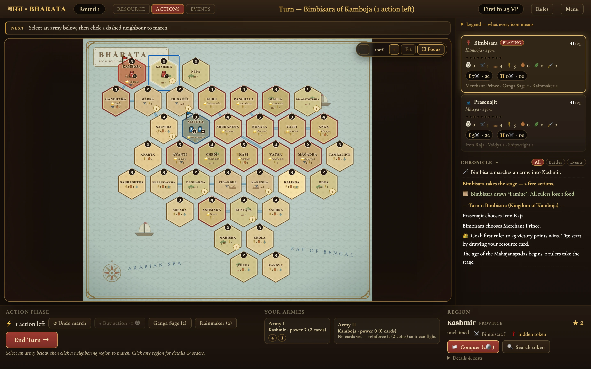
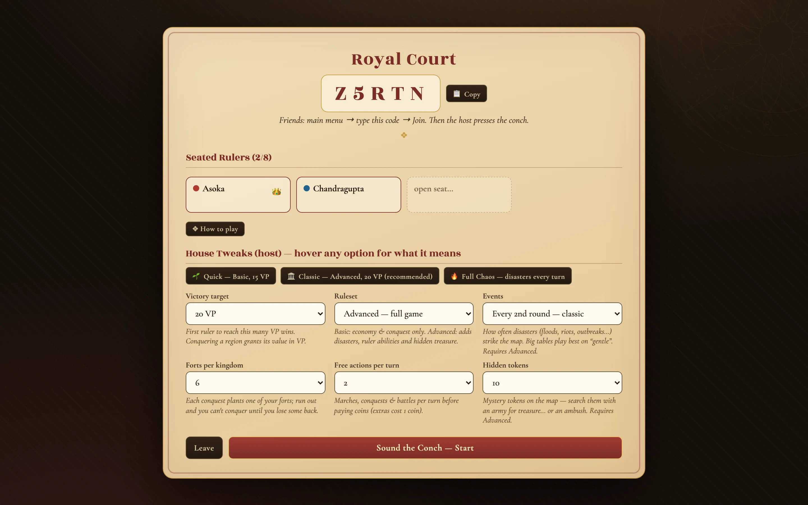
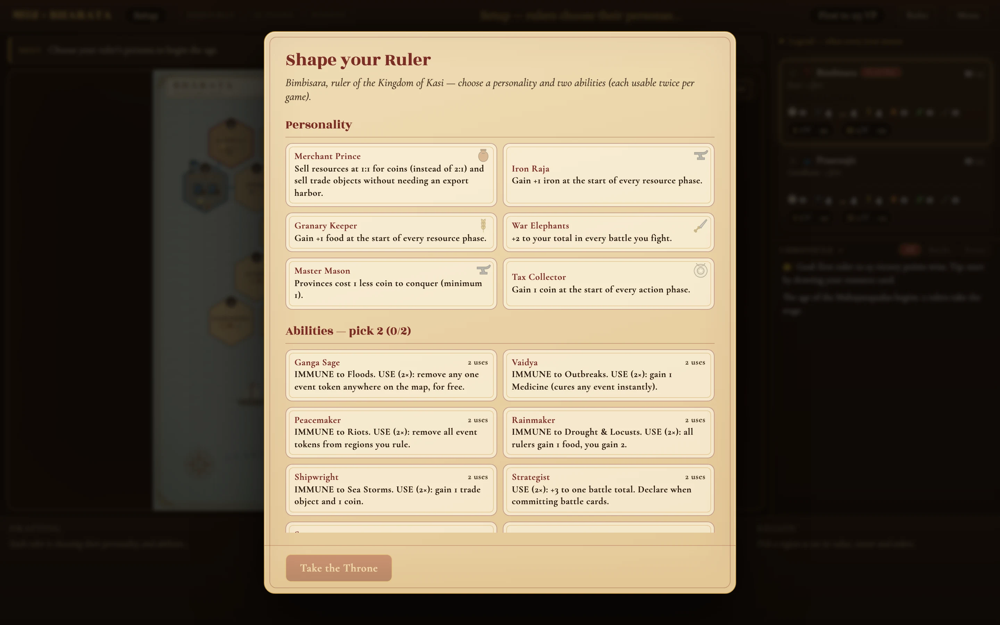
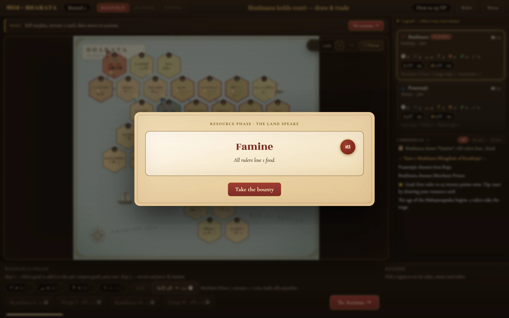
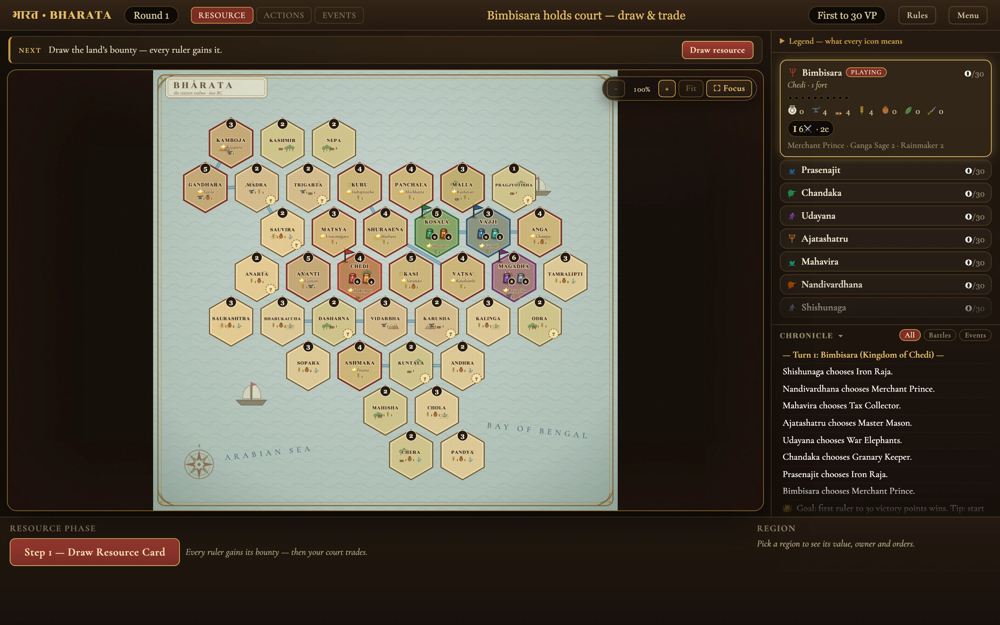
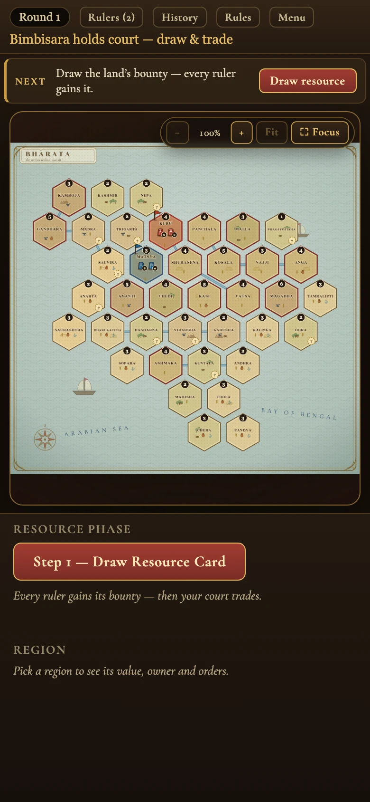
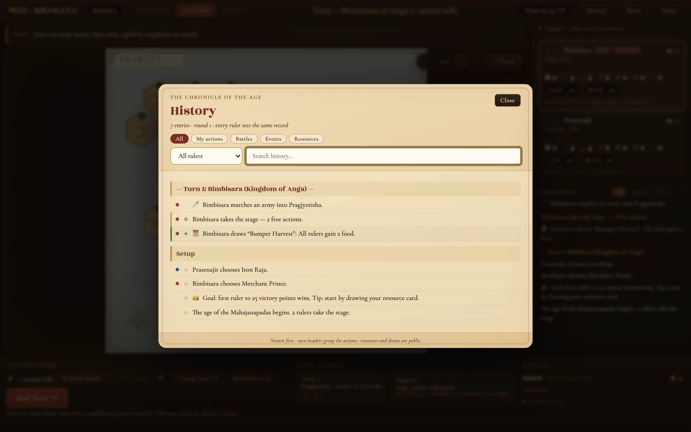
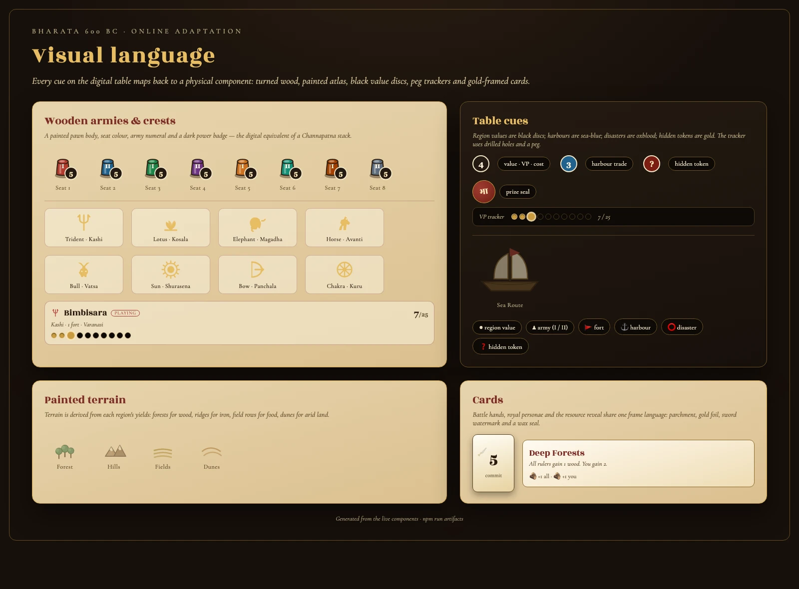
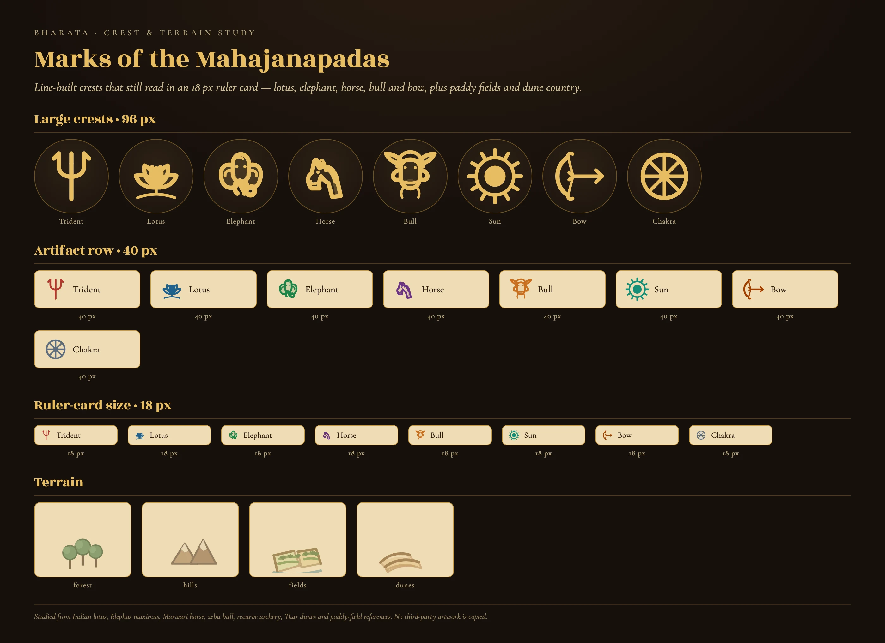

# भारत · BHARATA 600 BC — Online

<video src="https://github.com/user-attachments/assets/2fe8c7de-086c-49b0-95dc-d3a567b40d81" controls autoplay loop muted playsinline width="100%" poster="https://raw.githubusercontent.com/ksajan/bharata/main/docs/screenshots/board.webp"></video>

**[▶ Watch the eight-second gameplay clip](https://github.com/user-attachments/assets/2fe8c7de-086c-49b0-95dc-d3a567b40d81)** — draw the land’s bounty, sell the surplus, march into Pragjyotisha and take a province.

A faithful browser adaptation of **Bharata 600 BC** — the strategy board game of the 16
Mahajanapadas. Draw the bounty of the land, coin it into armies, conquer provinces and Great
Kingdoms, weather disasters and riots, and be first to the victory target.

Play **same-screen** with friends around one device, or **online** with a room code — 2 to 8
rulers, on desktop or phone.

<p>
  <a href="#quick-start"><b>Quick start</b></a> ·
  <a href="#how-to-play-in-a-minute"><b>How to play</b></a> ·
  <a href="#screenshots"><b>Screenshots</b></a> ·
  <a href="#art-direction"><b>Art direction</b></a> ·
  <a href="#hosting-for-friends"><b>Hosting</b></a>
</p>

---

## Screenshots

| The table, mid-turn | Online royal court |
| --- | --- |
|  |  |
| **Draft your ruler** | **The land speaks** |
|  |  |
| **Eight rulers, one rail** | **Phone layout** |
|  |  |

**Action history** — search every turn, filter by ruler or kind, grouped by turn:



The **visual language** sheet shows how the digital cues map to the physical pieces:



---

## Features

- **2–8 rulers** — 2–4 solo kingdoms; 5–8 as co-ruled kingdoms sharing four thrones.
- **Two ways to play** — pass-and-play on one screen, or online rooms with a 5-character code,
  seat reclaim after a refresh, and automatic state sync. A third friend can **watch** a live room
  without taking a seat.
- **The full game** — resource deck, selling and harbour trade, army cards and forging, movement,
  conquest, secret simultaneous battle commits, forts, VP-stealing conquests, prize conditions,
  disasters, abilities and hidden tokens.
- **A board you can actually read** — fit-to-pane map, 100–400 % zoom (buttons, wheel, pinch),
  drag-to-pan, and a distraction-free **Focus** mode.
- **Table cues from the physical game** — painted terrain, wooden pawns with power badges, black
  value discs, a peg-hole VP tracker and gold-framed cards.
- **Guided turns** — a one-step coach (“draw”, “select an army”, “march”), disabled-reason
  tooltips, and an end-turn guard that won't forfeit actions by accident.
- **Action feedback** — marches leave a trail and a destination ripple, conquests flash the tile,
  and every coin/resource/VP change appears in a short transaction ledger over the board.
- **Legible tiles** — hover a region for its value, owner and yields; legal marches are gold-lit,
  and the sidebar shows turn order and a drilled VP track.
- **Action history** — a searchable Chronicle modal (also on phones) with All / My actions /
  Battles / Events / Resources filters, ruler and round filters, entries grouped by turn, map
  jumps, archived resource card faces, and **battle records with committed cards + replay**.
  Your own ruler is marked **you**, and co-ruled kingdoms show **shared**.
- **Stable layout, one motion scale** — the board never resizes when text changes; the coach,
  dock, drawers and overlays share a fixed geometry, and every animation runs on the same
  duration/easing tokens (with reduced-motion support).
- **Table social** — eight quick emotes (👋 👍 🔥 😮 😅 🙏 ⚔️ 👑) with a per-seat cooldown, broadcast
  to every seat and watcher. Watchers see the same live table through a seat-less, secret-free view
  and cannot act or emote. There is no free-text chat.
- **Survives real life** — same-screen games resume after a refresh; online seats rejoin.
- **Playable on phones** — responsive menu and setup, a Rulers drawer, zoomable board.
- **Keyboard and screen-reader support** — arrow keys walk the hex lattice, Enter selects, Esc
  clears; regions and the chronicle are announced. In-game shortcuts: **H** History, **?** Rules.
- **Colour-blind-safe armies** — every army pawn carries a seat pattern as well as colour, and
  player cards keep a crest + turn-order chip. Co-ruled kingdoms are marked **shared** and explain
  what is shared (territory, forts) versus personal (resources, armies, VP).

---

## Quick start

```bash
npm install

# development: rules server on :3001, Vite client on :5173
npm run dev          # open http://localhost:5173

# production: build once, serve everything from one process
npm start            # http://localhost:3001
```

Requires **Node 18+**. Hosting notes are below.

---

## How to play in a minute

1. **Draft** a personality and two abilities. The first ruler to the victory target wins.
2. **Resource phase** — draw a resource card; **every ruler gains its bounty**, then the active
   court may sell surplus (2 resources → 1 coin; trade goods need an export harbour), recruit or
   forge army cards.
3. **Action phase** — take **2 free actions** (extra actions cost 1 coin):
   - **March** an army one region.
   - **Conquer** a region with your army present: provinces cost coins equal to their value;
     Mahajanapadas cost army cards. Conquering plants a fort and grants its value in VP.
   - **Battle** a rival army: both sides secretly commit army cards simultaneously; the defender
     adds the region's terrain value (max +3).
   - **Search** hidden tokens, **clear** disasters, or use an ability.
4. **Events** (advanced) — an omen lands on the map. Afflicted rulers must spend an action and
   resources to clear it; ignored riots topple forts.
5. **End turn** — victory-point conditions are checked, a prize card is drawn, and play passes on.

The in-game **Rules** button covers every option, card and edge case.

### House tweaks (host)

| Setting | Default | Notes |
| --- | --- | --- |
| Victory target | 20 VP | 25 at 2 players; scales up for 5+ |
| Ruleset | Advanced | Basic drops disasters, abilities and hidden tokens |
| Events | Every 2nd round | Every turn, every 3rd round, or off |
| Forts per kingdom | 6 | Conquests plant forts; run out and you cannot conquer |
| Free actions | 2 | Extras cost 1 coin |
| Hidden tokens | 10 | Search them with an army for treasure… or an ambush |

Presets: **Quick** (basic, 15 VP), **Classic** (advanced, 20 VP), **Full Chaos** (disasters every
turn).

---

## How the physical game maps to the screen




| Physical component | Web adaptation |
| --- | --- |
| Painted map of ancient India | 38-region hex atlas (16 Mahajanapadas + provinces) with terrain derived from each region's yields, rivers, harbours, ships and sea labels |
| Handmade Channapatna armies | Wooden-pawn pieces with a seat colour **and a seat pattern**, an army numeral and a dark power badge |
| Player trackers with peg holes | Ruler cards with a kingdom crest and a drilled VP track |
| Black value discs / blue harbour markers / red disaster tokens | Region value badges, harbour trade accents, disaster tokens; gold `?` marks hidden tokens |
| Army cards, personality cards, prize deck | Gold-framed parchment cards, personality emblems, wax-seal reveals |
| Secret simultaneous commits | Battle modal with both hands revealed after commit |

---

## Art direction

The physical edition is a painted atlas: muted land, blue-green sea, hand-drawn borders,
Channapatna wooden pieces, cream peg trackers and colour-coded illustrated cards. We studied the
publisher's component photography and the designers' notes on the art, then translated the
*visual cues* — not the artwork — into vector form:

- **Land** is tinted by its yield (forest for wood, ridges for iron, paddy plots for food, crescent
  dunes for arid), with rivers and harbours drawn in ink. Fields carry bunds, furrows and rice
  tufts; dunes have a sharp crest, slip-face shadow and wind ripples.
- **Crests** are drawn as small line-built seals that still read at ruler-card size: an open lotus
  with a seed pod, a fan-eared elephant, a Marwari horse head, a humped zebu bull and a strung
  recurve bow. The 96/40/18 px study is generated from the same components as the game.
- **Sea** is a pale blue-green wash with wave hatching, two sailing ships and spaced
  `ARABIAN SEA` / `BAY OF BENGAL` labels.
- **Values** are black discs with cream numerals, as on the printed board.
- **Armies** are turned-wood pawns with a numeral and a power badge.
- **Trackers** use a crest and ten drilled holes with a coloured peg.
- **Cards** keep one frame language: parchment, gold foil, a sword watermark and a wax seal.

References (used for research only — no assets are copied):

- [GoIndia Games — Bharata 600 BC product page](https://goindiagames.com/products/bharata-600-bc)
- [BoardGameGeek — Bharata 600 BC](https://boardgamegeek.com/boardgame/325882/bharata-600-bc)
- [The Hindu — “These board games pack in fun facts about being Indian”](https://www.thehindu.com/life-and-style/these-board-games-pack-in-fun-facts-about-being-indian/article33395093.ece)
- [The New Indian Express — “Pieces with a purpose”](https://www.newindianexpress.com/cities/bengaluru/2020/Dec/08/pieceswith-a-purpose-2233105.html)

Bharata 600 BC is designed by Cristina Maiorescu and Sumit Sinha, illustrated by Ishan Trivedi,
art-directed by Pallavi Nopany, and published by GoIndia Games. This is an independent fan
adaptation for playing with friends; it is not affiliated with or endorsed by the publisher.

---

## Architecture

```
shared/    pure TypeScript rules engine + map, decks, personalities, abilities
server/    Express + Socket.IO: rooms, seats, host config, reconnect, sanitisation
client/    React + Vite: menu, lobby, SVG atlas, command dock, modals, rules guide
e2e/       Playwright journeys (UI + socket-level) and the visual capture scripts
scripts/   simulations, playtest invariants, perf budget, artifact generation
```

- The engine is **deterministic and seeded**; the server is authoritative and sends each client a
  sanitised view (decks and hidden tokens are never leaked).
- Hot-seat and online share the same engine and screens; the transport is the only difference.
- State at rest: a versioned `localStorage` snapshot for same-screen resume (~7 KB).

---

## Testing and performance

```bash
npm run typecheck        # TypeScript, no emit
npm run test:ui          # 22 Playwright journeys (hot-seat, online, conquer, economy, guidance,
                         # accessibility, resume, setup, board geometry, history, perspective,
                         # spectator + emotes, tablet/landscape, battle handoff, prize hover, final table,
                         # deterministic menu/board visual snapshots + browser smoke)
npm run e2e              # socket e2e: rejoin, spectator, emote cooldown, lobby security, 6-room soak
npm run e2e:security     # lobby does not expose hostKey; no second socket seat takeover
npm run e2e:soak         # independent multi-room create/join/start/draft/action
npm run test:browsers    # Chromium + WebKit smoke
npm run sim              # simulated full games + rule assertions
npm run sim:invariants   # state invariants after every action
npm run sim:battles      # a forced battle verifies persisted battle records
npm run sim:edges        # prize/battle/fort/token edge regressions
npm run perf             # render + bundle budget (dev server on :5173)
```

Latest measurements: **~106 kB gzip** initial JS (rules guide split into its own 2.2 kB chunk),
**no long task over 50 ms**, and local UI interactions do not re-render the 38-region board.

---

## Hosting for friends

Any Node 18+ host works — one process serves the API, sockets and the built client.

```bash
npm run build
PORT=3001 npm run serve
```

- Expose the port with a tunnel (cloudflared, Tailscale Funnel, ngrok) or a small VPS
  (Render, Railway, Fly.io: build `npm run build`, start `npm run serve`).
- For a separate client origin, set `ALLOWED_ORIGINS="https://your.client"` on the server.
- Share the **5-character room code** from the lobby; friends join from the main menu.
  Seat tokens are stored per browser, so a refresh rejoins automatically.

---

## Regenerating the images

With the dev server running on `:5173`:

```bash
npm run artifacts
```

This captures the real UI at 2× into `docs/screenshots/*.webp` and renders the component sheet
from the same React art components the game uses. Requires `cwebp` (from `webp`).

```bash
npm run demo       # records docs/screenshots/turn-v3.mp4 (requires ffmpeg)
npm run art:study  # renders the crest + terrain study from the React art
```

The README video is a GitHub user-attachment (so github.com serves it with the right MIME type and
the inline player works). Upload a fresh `turn-v3.mp4` as a comment/issue attachment to replace it,
then update the two URLs in the video block above.

---

## Credits

- Original game: **Bharata 600 BC**, GoIndia Games.
- Rules engine, server and interface: this repository.
- Type: Rozha One & Cormorant Garamond.
